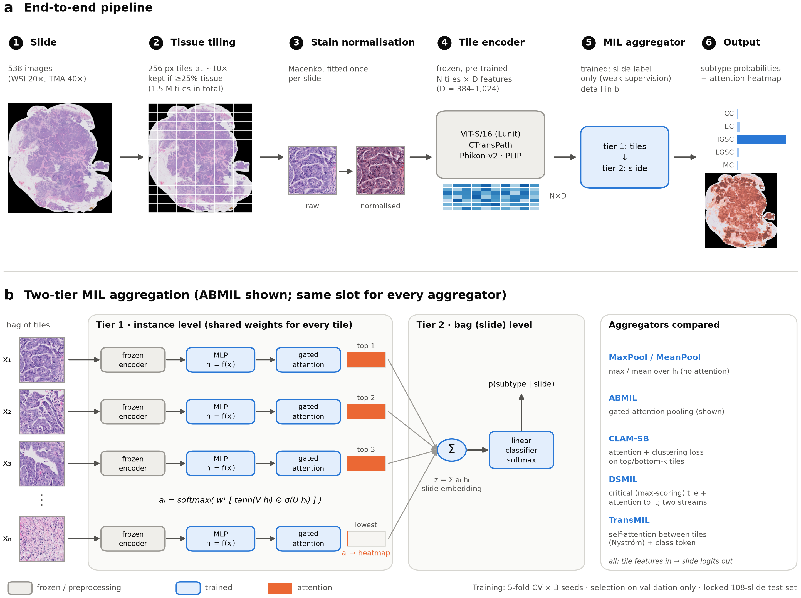

# Ovarian cancer subtype classification with foundation encoders and multiple instance learning

Code, notebooks and results for a benchmark of **4 tile encoders × 6 MIL aggregators** on the
[UBC-OCEAN](https://www.kaggle.com/competitions/UBC-OCEAN) dataset: 538 H&E whole-slide and tissue-microarray images,
5 subtypes (clear cell CC, endometrioid EC, high-grade serous HGSC, low-grade serous LGSC, mucinous MC).



## What is in the benchmark
| Step | Choice |
|---|---|
| Split | Locked test set of 108 slides + 5-fold CV on the other 430, stratified by subtype × WSI/TMA (seed 42). Per-slide split (UBC-OCEAN has no patient IDs). |
| Tiling | 256 px tiles at ~10×, kept if ≥ 25 % tissue → 1,514,983 tiles |
| Stain normalisation | Macenko, fitted once per slide on tissue pixels, GPU apply |
| Encoders (frozen) | ViT-S/16 (Lunit DINO), CTransPath, Phikon-v2, PLIP |
| MIL aggregators | MaxPool, MeanPool, ABMIL (gated attention), DSMIL, CLAM-SB, TransMIL |
| Protocol | 5 folds × 3 seeds per configuration; epoch and hyperparameters chosen on validation only; test = 15-model ensemble, 95 % bootstrap CI; paired bootstrap tests with Holm correction |

## Main results (locked 108-slide test set)
| Configuration | Balanced acc. [95 % CI] | Accuracy | Macro AUROC |
|---|---|---|---|
| ViT-S/16 + MaxPool (best by CV) | 0.834 [0.74–0.92] | 0.852 | 0.976 |
| Phikon-v2 + ABMIL, tuned (best observed) | 0.872 [0.79–0.94] | 0.880 | 0.978 |

- No pair of configurations differs significantly on the 108-slide test set (paired bootstrap, Holm). After tuning ABMIL and DSMIL, no encoder differs significantly from ViT-S/16 on either CV or test.
- ABMIL attention vs pathologist tumour masks: **AUROC 0.968 [0.949–0.983]** over 138 slides.
- The dominant error is **EC predicted as HGSC**: 16 % of EC slides on CV (16/99, 95 % CI 10–25 %) vs 5 % in the reverse direction; it is the largest off-diagonal cell in 31 of 32 trained configurations.

Full tables, significance tests, tuning and interpretability: [docs/RESULTS.md](docs/RESULTS.md). Method details: [docs/METHODS_NOTES.md](docs/METHODS_NOTES.md). Dataset counts: [docs/DATASET_TABLE.md](docs/DATASET_TABLE.md).

## Repository layout
```
code/
  make_splits.py            regenerates splits_v2/ from data/kaggle_train.csv
  splits_v2/                locked test set + 5 CV folds (assignment.csv = everything in one table)
  extract/featx.py          tiling, per-slide Macenko, feature extraction for all encoders in one pass
  mil/                      models, training, evaluation, grid runner, tuning, significance tests
  figures/                  scripts for every figure in figures/
  tests/                    fake features for CPU testing
kaggle/
  01–06_*.ipynb             the notebooks that produced every result (run on Kaggle, 2× T4)
  build_*.py                generate the notebooks from code/ (edit code/, then rebuild)
  results_01 … results_06   outputs downloaded from each Kaggle run (predictions, logs, summary tables)
figures/                    paper figures (PDF + PNG)
docs/                       results, methods notes, dataset table
```

## Reproduce
All GPU work runs on Kaggle, where the UBC-OCEAN images are already available.

| Notebook | What it does | Time (2× T4) | Output |
|---|---|---|---|
| `01_test_patching_macenko` | checks tissue detection and Macenko on a few slides | < 1 h | `results_01` |
| `02_extract_features` | tiles + Macenko + 4 encoders for all 538 slides | ~6 h | features (Kaggle dataset, ~8 GB) |
| `03_train_mil` | 4 encoders × 6 models × 5 folds × 3 seeds, results tables, significance tests | ~3.5 h | `results_03`, `results_04` |
| `04_figures` | t-SNE, attention heatmaps, attention vs tumour masks | ~1 h | `results_05` |
| `05_tune` | 13 settings for ABMIL / DSMIL per encoder on CV, best retrained with 3 seeds | ~3.5 h | `results_06` |
| `06_closeups` | high-resolution attention close-ups | < 30 min | `figures/fig_heatmap_closeups` |

Attach the UBC-OCEAN competition data (and, for 03–06, the output of notebook 02) and run with *Save Version → Save & Run All*.
Each notebook resumes from a previous version's output if one is attached.

Local (CPU) use, e.g. figures from the saved results:
```bash
pip install -r requirements.txt
cd code
python figures/make_figures.py --kaggle ../kaggle --out ../figures
python figures/make_confusion.py --kaggle ../kaggle --out ../figures
python -m mil.stats --help
```
Test the training code without any real data:
```bash
cd code
python tests/make_fake_features.py --splits splits_v2 --out fake_features
python -m mil.train --features fake_features --splits splits_v2 --model abmil --fold 1 --epochs 15 --out runs/fake/abmil/seed0
```

## Data and model licences
- UBC-OCEAN images and labels belong to the competition organisers and are subject to the Kaggle competition rules. `code/data/kaggle_train.csv` is the competition's label file, included so the splits can be regenerated.
- Encoder weights are downloaded from their original sources and are not redistributed here. Phikon-v2 is released for non-commercial use only; check each model's licence before use.

## Acknowledgements
The original capstone version of this project started from [m1dsolo/UBC-OCEAN-7th](https://github.com/m1dsolo/UBC-OCEAN-7th). The code here is a rewrite with a fixed ABMIL attention, a locked test set and a new evaluation protocol.

## Licence
Code: MIT (see [LICENSE](LICENSE)).
